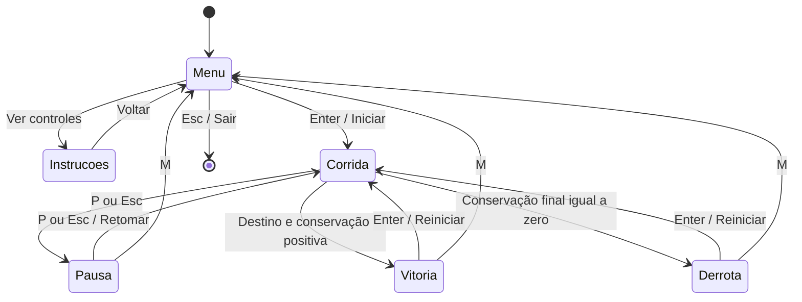

# Telas e técnicas gráficas

Estado: esboços textuais e decisões propostas, sem capturas de um jogo executado.

## Telas e fluxo



Fechar a janela encerra o programa em qualquer estado. Botões visíveis poderão ser selecionados por setas e Enter; o teclado será suficiente. Na tela de instruções, Esc retorna ao menu. Vitória e derrota podem compartilhar a mesma implementação de tela de resultado, variando o texto.

Janela proposta: 960 × 540 pixels. Usar texto grande, margens consistentes e contraste entre personagem, obstáculos e fundo. A conservação terá número e rótulo além da cor, para que o aviso não dependa apenas da percepção de cores.

### Menu

```text
┌──────────────────────────────────────────────────┐
│               CORRE QUE DERRETE!                 │
│  Entregue o sorvete antes que a conservação zere. │
│                                                  │
│    [Iniciar]    [Como jogar]    [Sair]             │
│        Setas: escolher • Enter: confirmar         │
└──────────────────────────────────────────────────┘
```

### Instruções

Mostrar objetivo, salto, pausa, efeito do impacto e efeito do gelo com pequenos desenhos e texto. Explicar que a corrida é automática. Botão “Voltar” e indicação de Esc.

### Corrida

```text
┌──────────────────────────────────────────────────┐
│ Sorvete: 75/100 [██████░░]   Rota: 40%  Trecho 2/3 │
│ Céu e nuvens: camada distante                     │
│ Prédios: camada intermediária                     │
│                                                  │
│     entregador →      gelo       caixa            │
│────────────────────────────────────────── chão ──│
│ Espaço/↑: saltar • P/Esc: pausa                    │
└──────────────────────────────────────────────────┘
```

HUD fixo na tela: conservação, progresso em porcentagem e trecho atual. Ao ficar abaixo de 25 pontos, exibir “O sorvete está derretendo!” e alterar o preenchimento da barra. Mostrar “+15 gelo” apenas quando o ganho real for 15; perto do limite, exibir o ganho efetivo ou apenas “Gelo coletado”. Impacto terá feedback de “−20” e piscar durante a proteção.

### Pausa e resultado

Pausa: sobreposição escurecida sobre a corrida congelada, com “Pausado”, “Retomar”, “Menu” e “Sair”.

Vitória: “Entrega concluída!”, conservação restante, distância concluída e opções de reiniciar, menu e sair. Derrota: “O sorvete derreteu!”, progresso alcançado e as mesmas opções. Ambos devem deixar explícito que Enter reinicia e M volta ao menu. As teclas de navegação e os botões precisam funcionar sem editar código.

## Três técnicas gráficas principais

| Técnica | Onde e por quê | Implementação planejada | Evidência futura |
| --- | --- | --- | --- |
| Parallax | Nuvens e prédios com velocidades diferentes dão profundidade e comunicam avanço | Deslocar camadas com fatores de 0,2 e 0,5 em relação à distância da rota; chão e objetos usam fator 1. Repetir fundos sem lacunas | Comparar deslocamentos das camadas e explicar os fatores no código |
| Animação por quadros | Corrida e salto tornam o movimento legível | Sequência de quatro quadros de corrida a cerca de 10 quadros/s; dois quadros de salto, subida e descida, escolhidos pela velocidade vertical. Temporização independente da taxa de renderização | Exibir sequência de quadros e transição de corrida para salto |
| Partículas | Pequenos cristais na coleta e gotas quando a conservação está baixa reforçam as regras | Primitivas com posição, velocidade, tempo de vida e transparência; atualizar por delta de tempo e remover ao expirar. Limite proposto de 100 partículas simultâneas | Demonstrar emissão, movimento e desaparecimento; verificar limite e reinício |

As três técnicas são escolhidas para cumprir o mínimo do enunciado com efeitos ligados à experiência. Rolagem, composição por camadas e transformação entre coordenadas de mundo e tela complementam a explicação, sem substituir essas três técnicas principais.

## Coordenadas, camadas e colisões

Manter posições lógicas em coordenadas de mundo. Converter para tela com `x_tela = x_mundo - deslocamento_camera`. A câmera acompanha o avanço automático; o personagem permanece perto do lado esquerdo. HUD usa coordenadas de tela e não se move com o cenário. Nunca usar o fator de parallax para posicionar hitboxes de objetos jogáveis.

Ordem de desenho: céu → nuvens → prédios → chão → objetos e personagem → partículas → HUD → sobreposições. Hitboxes menores que bordas decorativas dos desenhos ajudam a evitar impactos aparentemente injustos.

Método inicial: retângulos alinhados aos eixos (AABB), com `pygame.Rect.colliderect`, em um único sistema de coordenadas. O contato com o chão limita a posição vertical e libera o próximo salto; contato com obstáculo causa dano; contato com gelo causa recuperação. Mostrar hitboxes em um modo de depuração futuro para explicar e ajustar o método.

Usar passo de simulação proposto de 1/60 s e posições lógicas em ponto flutuante. Limitar o intervalo acumulado após travadas e verificar se a distância percorrida por passo é compatível com a largura das hitboxes. Colisões e temporizadores devem ser testados no computador de demonstração; não há desempenho medido nesta etapa.

## Recursos visuais mínimos

Produzir futuramente quatro quadros de corrida e dois de salto, desenho do gelo, cone, caixa, cliente/destino e duas camadas de fundo repetíveis. Pode-se começar com desenhos próprios simples e primitivas do Pygame. Não foi produzida nem selecionada arte final. Todo recurso externo adotado deverá entrar no arquivo de créditos com autor, link e licença disponível.
