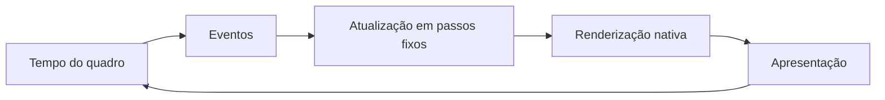
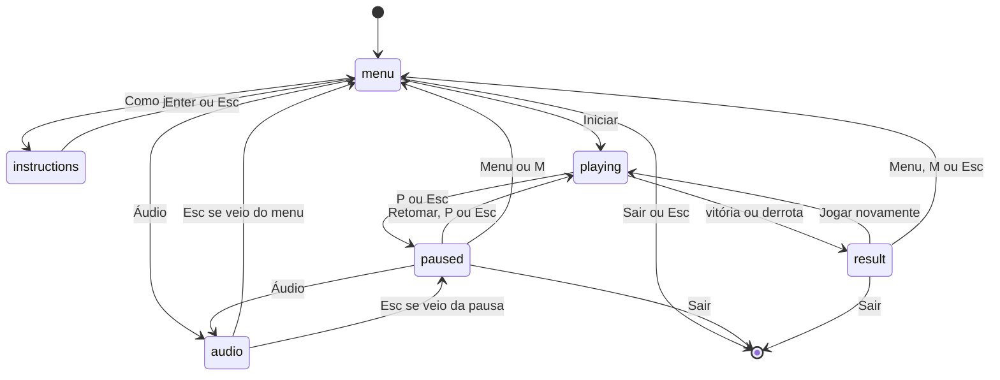

# Organização do código e técnicas para a apresentação

Estado conferido em 07/10/2026, implementação `23f755e`. Referências por módulo/função permitem localizar o código mesmo se números de linhas mudarem.

## Responsabilidades

| Arquivo | Responsabilidade e pontos de entrada |
| --- | --- |
| `main.py` | Chama `game.app.main`. |
| `game/app.py` | `App`: eventos, estados e tempo acumulado; `main`: inicialização e laço. |
| `game/settings.py` | Constantes de movimento, dimensões lógicas, dificuldade e tempo. |
| `game/entities.py` | `Player`: salto/gravidade/hitbox; `WorldObject`: dados e retângulo; `build_route`: posições fixas. |
| `game/run.py` | `Run`: conservação, distância, progressão, pontuação, colisões, avisos e resultado. Não lê teclado nem tamanho da janela. |
| `game/graphics.py` | `Renderer.resize/draw/world/hud/destination/delivery`: composição, caches, textos, HUD e telas. |
| `game/window.py` | `Window`: janela, F11, redimensionamento, área 16:9 e apresentação. |
| `game/drawing.py` | `Draw`: converte coordenadas gráficas e espessuras para pixels atuais. |
| `game/parallax.py` | `Parallax`: criação das camadas e rolagem repetida; `layer_offset`. |
| `game/animation.py` | `CourierAnimation`: quadros de corrida/salto/entrega; `draw_customer`: cliente frontal. |
| `game/particles.py` | `Particle/Effects`: emissão, movimento, vida e desenho dos efeitos cosméticos. |
| `game/palette.py` | Cores compartilhadas para identidade visual. |
| `game/audio.py` | `Audio`: música, preferências e falhas não fatais. |
| `assets/audio/` | Ogg redistribuído e créditos/licença. |
| `tests/` | Regras, interface, técnicas, resolução e áudio; não contém validação humana. |

O controlador liga as partes: recebe eventos, atualiza `Run` e pede ao renderizador que desenhe. `Run` inclui `Effects`, mas partículas são cosméticas e não geram colisões/dano. A janela fornece a superfície nativa; áudio é um controlador separado e não depende das transições para tocar novamente.

## Loop e controle de tempo

Em `game/app.py:main`, a cada quadro:

1. `Clock.tick(TARGET_FPS)` limita a taxa alvo a 60 e fornece o tempo em milissegundos, convertido para segundos.
2. `pygame.event.get()` lê os eventos; `Window.handle_event` trata F11/tamanho; os demais vão a `App.handle_event`.
3. `App.update(frame_time)` atualiza somente em `playing`. Uma mudança de estado descarta o tempo do quadro anterior, evitando aplicar o tempo da pausa ao retornar.
4. O tempo é limitado a 0,25 s e acumulado. Enquanto há pelo menos 1/60 s, `Run.update(FIXED_STEP)` avança a simulação. Ao finalizar a corrida, entra em `result`.
5. `Window.prepare_frame`, `Renderer.resize`, `Renderer.draw` e `Window.present` desenham e exibem a cena. `pygame.quit` encerra os subsistemas.

Tempo fixo favorece resultados consistentes com taxas de renderização diferentes. Uma travada longa tem o tempo excedente descartado; não é promessa de simulação em tempo real durante travamentos. Não há interpolação entre passos de física. 60 FPS é alvo, não taxa medida.

## Estados

Fechar a janela encerra em qualquer estado. Vitória/derrota são valores de `Run.result`, exibidos no mesmo estado `result`. `audio_return` guarda a origem. Em Áudio vindo da pausa, a corrida não é atualizada; a música continua salvo se desligada pelo usuário. Reiniciar cria um novo `Run`, mas conserva o controlador de áudio e suas preferências.

## Movimento, coordenadas e colisões

O sistema lógico tem referência de 960 × 540, eixo x à direita e y para baixo. O avanço horizontal é `distance += speed * dt`; o entregador permanece próximo de x=200 na tela. No mundo, sua hitbox usa `distance + PLAYER_SCREEN_X`. Objetos têm x fixo; no desenho, `x_tela = x_mundo - distance`. HUD e menus não recebem deslocamento de câmera.

`Player.jump` aplica velocidade vertical -640 apenas no chão. `Player.update` faz `velocity_y += 1800 * dt` e depois `y += velocity_y * dt` (integração de Euler semi-implícita). Ao atingir o chão, limita y a `430 - 68`, zera velocidade e marca `grounded`. Não há salto duplo ou colisão por pixels.

`Player.rect` e `WorldObject.rect` constroem `pygame.Rect` arredondados em coordenadas de mundo. **AABB** significa retângulos alinhados aos eixos: `colliderect` verifica sobreposição. Toque apenas na borda não é sobreposição pelo método. Cone usa retângulo de 38 × 44, caixa 50 × 58, gelo 32 × 32 e jogador 42 × 68. A arte pode ultrapassar essas hitboxes; contorno triangular do cone não é usado como máscara. É uma aproximação simples e explicável, não detecção da silhueta exata ou colisão contínua.

Em `Run.update`, movimento e timers são atualizados, há derretimento de 2 pontos percentuais/s e então impactos, coletas, limites e resultado. Um obstáculo é marcado `consumed` ao contato, inclusive sob proteção, para evitar dano repetido nessa passagem. Se a proteção está zerada, tira 20 pontos percentuais e ativa 0,8 s sem novo dano. Gelo também é consumido uma vez, soma até 15 pontos percentuais (máximo 100%) e 100 pontos. Ao final, zero causa derrota antes da verificação de chegada; gelo no mesmo passo pode salvar a corrida.

`Run.stage` divide distância em três trechos de 6000 unidades; `speed` escolhe 260/300/340. `build_route` define obstáculos mais próximos no fim, sem aleatoriedade de dificuldade. Pontuação é `int(distance / 10) + 100 * ices`. Vitória depende da conservação positiva ao atingir 18000 unidades, não de uma colisão física com o cliente decorativo.

## Técnica 1 — parallax e camadas

**Onde:** `game/parallax.py:Parallax.__init__/draw`, `layer_offset`; chamada em `Renderer.world`. Nuvens fator 0,15; prédios 0,35; fachadas 0,70. Chão e objetos acompanham fator 1. O céu permanece fixo; HUD também.

O deslocamento de cada camada é `(distance * scale * factor) % largura_do_tile`. O módulo faz repetição cíclica; cópias cobrem a superfície. Quanto menor o fator, mais lenta a rolagem e mais distante parece a camada. É uma ilusão de profundidade 2D; não há perspectiva 3D. Superfícies são geradas uma vez e refeitas ao mudar a resolução.

**Mostrar:** durante a corrida, comparar nuvens lentas com fachadas/chão rápidos. Explicar por que o HUD não se move. Testes de fatores/repetição estão em `tests/test_graphics.py`.

## Técnica 2 — animação por quadros

**Onde:** `game/animation.py:CourierAnimation.make_frame/frame_index/frame/draw`; uso em `Renderer.world`. São seis quadros de corrida gerados por primitivas, dois de salto e uma pose de entrega. Quadros transparentes são armazenados em cache.

No chão: índice `int(elapsed * 10) % 6`, ou dez trocas de quadro por segundo, independente dos FPS de desenho. No ar: velocidade negativa escolhe joelhos recolhidos na subida; velocidade não negativa escolhe descida. Não é animação esquelética; a troca das imagens dá a impressão de movimento. A hitbox não acompanha as mudanças das pernas. A pausa congela `elapsed`, portanto congela a pose.

**Mostrar:** corrida e salto; apontar pose de subida/descida e perfil do entregador. Testes de quadros distintos, seleção e pausa em `tests/test_graphics.py`.

## Técnica 3 — partículas e feedback

**Onde:** `game/particles.py:Particle`, `Effects.emit/burst/update/draw`; disparos em `Run.update` e composição em `Renderer.world/hud`.

Cada partícula tem posição de mundo, velocidade, vida inicial e restante. O update reduz vida, move por `velocidade * dt`, aplica aceleração vertical e elimina partículas expiradas. Desenho subtrai câmera; transparência decresce com `remaining / lifetime`. No máximo 100 partículas ficam ativas. Gerador aleatório local com semente 7 varia o visual sem alterar as regras.

Coleta emite 16 cristais cianos; impacto com dano emite 12 faíscas alaranjadas; abaixo de 25% de conservação emite duas gotas rosadas a cada 0,12 s perto do sorvete. Formas diferentes, avisos e flashes distinguem eventos; conservação baixa também pulsa o contorno do HUD. As gotas não causam perda: a regra de derretimento está em `Run`.

**Mostrar:** gelo, impacto e conservação baixa; explicar nascimento, atualização e descarte. Limite, vida, eventos, pausa e reinício testados em `tests/test_graphics.py`.

## Técnicas complementares e nitidez

`Window.viewport_rect/prepare_frame` obtém a maior área 16:9 que cabe, com margens quando necessário. `Renderer.resize` rasteriza fontes e regenera caches na resolução final. `Draw` aplica escala só no desenho: `(x_pixel, y_pixel) = (x_lógico * scale, y_lógico * scale)`. `Window.present` usa cópia direta, sem ampliar a cena pronta. F11/tamanho não alteram física ou colisões.

Quadros e nuvens são gerados a 2× a resolução de destino e reduzidos para suavizar bordas; círculos/polígonos usam recursos de desenho/antialiasing. A composição combina cenário, objetos, personagem, partículas, HUD e painéis sobrepostos. Esses recursos complementam as três técnicas principais; não é necessário contar áudio como técnica de Computação Gráfica.

## Como conferir e explicar sem extrapolar os testes

Suítes: regras (`test_rules.py`), interface (`test_ui.py`), técnicas (`test_graphics.py`), resolução (`test_resolution.py`) e áudio (`test_audio.py`). O último marco registrou 59 testes passando, com SDL dummy. Eles verificam lógica e renderização programada, sem substituir jogador real, audição ou medição de FPS. O usuário agora confirmou visual e áudio satisfatórios no Windows; isso não registra automaticamente cada caso individual da suíte.

Para a defesa, localizar as funções acima e explicar: por que usar tempo; diferença entre mundo/tela/pixels; por que a hitbox não muda com a janela; como remover partículas; onde a vitória é decidida. Executar a demonstração e o ensaio no computador escolhido, conforme o roteiro.
